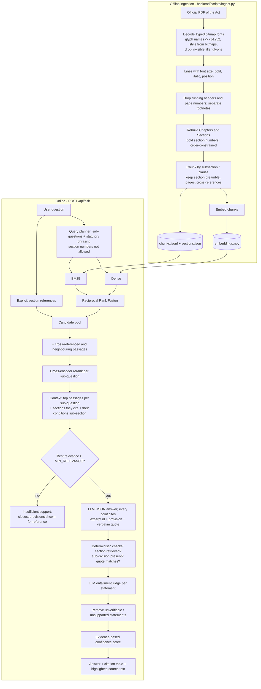

# Income-tax Act, 1961: Citation-Grounded Question Answering

Ask a question in plain English about the Income-tax Act, 1961. The application retrieves the relevant provisions from the official text of the Act and answers **only from those provisions**. Every statement is cited with its **section, subsection or clause, source document and PDF page**. Each citation is **mechanically verified against the statute text** before it is shown.

> **Edition used:** *Income-tax Act, 1961 [43 of 1961], as amended by the Finance Act, 2026*. This is the CBDT consolidated text published on [incometaxindia.gov.in](https://www.incometaxindia.gov.in/documents/d/guest/income_tax_act_1961_as_amended_by_fa_act_2026-1-pdf). The PDF has 1,098 pages and was created on 4 April 2026; its SHA-256 is `ecdd7ea6…f30db2fc`, recorded in full in `backend/data/processed/ingest_report.json`.
> **Important:** the 1961 Act was **repealed with effect from 1 April 2026** by the Income-tax Act, 2025. See [Edition and applicability](#edition-and-applicability).

**Contents:** [Structure](#project-structure) · [A. Overview](#a-project-overview) · [B. Technology stack](#b-technology-stack) · [C. Architecture](#c-architecture-and-approach) · [D. Setup](#d-setup-and-execution) · [E. Testing and limitations](#e-testing-and-limitations) · [Design decisions](docs/design_decisions.md) · [Sample results](docs/sample_results.md)

---

## Project structure

```
income-tax-qa/
├── backend/                          Python backend (FastAPI + retrieval-augmented generation)
│   ├── taxqa/
│   │   ├── core/
│   │   │   ├── config.py             all settings, read from backend/.env
│   │   │   ├── models.py             Section / Chunk domain models
│   │   │   └── llm_client.py         Gemini + OpenAI-compatible fallback, JSON mode, SQLite response cache
│   │   ├── ingestion/
│   │   │   ├── type3_decoder.py      recovers the text layer of the official PDF (Type3 bitmap fonts)
│   │   │   ├── pdf_reader.py         layout-aware text extraction; running headers and footnotes
│   │   │   ├── section_parser.py     Chapter -> Section reconstruction
│   │   │   └── chunker.py            subsection/clause chunks with pages and cross-references
│   │   ├── retrieval/
│   │   │   ├── onnx_models.py        model download from Hugging Face + onnxruntime inference (CPU or GPU)
│   │   │   ├── embeddings.py         local ONNX embeddings or Gemini embeddings
│   │   │   ├── hybrid_index.py       BM25 + dense index
│   │   │   ├── query_planner.py      sub-questions, statutory phrasing, explicit section references
│   │   │   ├── reranker.py           cross-encoder relevance scores (0-1)
│   │   │   └── retriever.py          rank fusion, cross-reference expansion, context selection
│   │   ├── answering/
│   │   │   ├── schemas.py            API response models
│   │   │   ├── generator.py          grounded, structured answer generation
│   │   │   ├── verifier.py           citation checks, entailment judge, removal of unsupported claims
│   │   │   └── confidence.py         evidence-based confidence score
│   │   ├── services/qa_pipeline.py   plan -> retrieve -> generate -> verify -> score
│   │   └── api/
│   │       ├── main.py               FastAPI app; also serves the frontend
│   │       └── routes.py             /api/ask, /api/search, /api/section/{num}, /api/health
│   ├── scripts/                      ingest.py, ask.py, evaluate.py, inspect_pdf.py,
│   │                                 make_colab_bundle.py, import_index.py
│   ├── tests/                        pytest suite (parser, decoder, retrieval, verifier, API, LLM client)
│   ├── eval/                         questions.jsonl + generated results_*.md / .json
│   ├── data/                         raw/ (the official PDF), processed/, index/, cache/ (generated)
│   ├── requirements.txt  pyproject.toml  .env.example
├── frontend/                         Static web UI, no build step
│   ├── index.html
│   └── assets/css/styles.css, assets/js/app.js
├── notebooks/                        build_index_colab.ipynb: optional index build on a free cloud GPU
├── docs/                             design_decisions.md, sample_results.md, screenshots
└── README.md
```

---

## A. Project overview

### Purpose
In a legal answer, the conclusion alone isn't enough. The reader must see *which provision* supports each conclusion and be able to check it. This system does not let the language model decide which law applies:

1. Relevant provisions are **retrieved** from the ingested Act.
2. The LLM answers **only from those excerpts**. It must attach an excerpt id, a precise provision and a verbatim quote to every statement.
3. A **verifier** checks every citation against the retrieved text and removes statements it cannot trace to the Act. The confidence score is then computed from what was verified.

### Features implemented
| Feature | Details |
|---|---|
| Decoding of the official PDF | The official FA 2026 PDF has no usable text layer (Type3 bitmap fonts). Its text is recovered exactly; see [Decoding the official PDF](#decoding-the-official-pdf) |
| Structure-aware ingestion | Rebuilds Chapter → Section → subsection/clause. Keeps PDF page numbers, section titles, chapters, amendment footnotes and cross-references |
| Hybrid retrieval | BM25 (exact legal wording, section numbers) + dense embeddings (meaning), fused by Reciprocal Rank Fusion |
| Query planning | Multi-part questions are split into sub-questions. Lay terms are rephrased into statutory vocabulary ("rented out" → "let out"). The LLM is **not allowed to name sections** |
| Explicit section lookup | "What does section 80C provide?" or "u/s 24(b)" fetches those sections directly |
| Cross-reference expansion | Sections referenced inside the top hits (e.g. 24 → 23) are always given to the LLM, and so is the sub-section that states a provision's conditions (e.g. 80EE(3)) |
| Cross-encoder reranking | 0–1 relevance per passage, also used for abstention and confidence |
| Structured, cited answers | Each statement carries section/subsection/clause, document name, PDF page and a verbatim quote |
| Citation verification | Section retrieved? Sub-division present? Quote matches the statute? Plus an LLM entailment check per statement |
| Removal of unsupported claims | Statements without a traceable citation, or judged unsupported, are removed and listed with the reason |
| Abstention | Weakly supported or out-of-scope questions get an explicit "insufficient support" or "out of scope" answer |
| Confidence score (optional feature) | Computed from verification and retrieval measurements, never self-reported by the LLM |
| Evaluation harness | 38 questions (34 answerable, 4 outside the Act) with expected sections; retrieval and end-to-end metrics |
| Free to run | Designed for an 8 GB, CPU-only laptop. Models run locally on ONNX; the LLM is the Gemini free tier. Indexing can be offloaded to a free Colab/Kaggle GPU |
| Free-tier aware | Gemini model fallback chain (an overloaded or retired model is skipped), bounded "thinking", SQLite response cache, and per-model daily call counts in `/api/health` and `ask.py` |

No answers, sections or questions are hardcoded. The example questions in the UI and in `backend/eval/` are only inputs.

---

## B. Technology stack

| Layer | Choice | Why | Alternatives considered |
|---|---|---|---|
| Language | Python 3.10+ | Required by the brief; best PDF/NLP ecosystem | n/a |
| PDF extraction | **PyMuPDF** + own Type3 decoder | Font size, position and per-character data, plus access to the font programs, which the decoder needs | pdfplumber (slower), OCR (Tesseract / Windows OCR: slower and not exact), LLM-based parsing (non-deterministic) |
| Lexical search | **rank-bm25** | Statutes depend on exact terms ("annual value", "80C") that embeddings blur | Elasticsearch/OpenSearch (needs a server), SQLite FTS5 |
| Embeddings | **BAAI/bge-base-en-v1.5, official ONNX export run with onnxruntime (CPU)**, optional `gemini-embedding-001` | Strong open retrieval model; runs offline with no GPU and no rate limits; reproducible indexing; only `onnxruntime` + `tokenizers` needed | OpenAI/Voyage (paid API), sentence-transformers (pulls in PyTorch, heavy on 8 GB RAM), fastembed (convenient wrapper but a dozen extra dependencies) |
| Vector search | **Exact cosine similarity over an in-memory NumPy matrix** | A few thousand chunks, so exact search takes milliseconds. An ANN index or DB server adds complexity without benefit | Qdrant / Chroma / pgvector (the next step if Rules, circulars or case law are added) |
| Reranker | **BAAI/bge-reranker-base cross-encoder, int8 ONNX export (onnxruntime, CPU)** | Reads question and passage together; far more precise than embeddings alone; gives the relevance signal used for abstention | Cohere Rerank (paid API), LLM-as-reranker (slow, uses quota) |
| LLM | **Google Gemini** over REST: `gemini-2.5-flash` writes answers; `gemini-3.5-flash-lite` plans queries and judges claims. Each role has a fallback chain | Free tier, native JSON output mode, long context. Bounded thinking keeps an answer at about 15 s instead of 1.5–3 min | Groq / OpenRouter / OpenAI (supported as **automatic fallback** via any OpenAI-compatible endpoint). Local models via Ollama were rejected: too slow and weak for legal reasoning on a CPU-only 8 GB laptop |
| Quote matching | **rapidfuzz** | Fast fuzzy matching that tolerates PDF whitespace and hyphenation | difflib (slow) |
| Backend | **FastAPI** | Typed request/response models; interactive docs at `/docs` | Flask |
| Frontend | **Static HTML/CSS/vanilla JS** in `frontend/`, served by FastAPI. Designed with the open-source [Hallmark](https://github.com/Nutlope/hallmark) design rules, Almanac theme: a two-pane workbench with the answer beside the Act's own text, quoted words marked | No build step; full control over how citations and checks are shown; checked with Hallmark's linter (0 failures) | Streamlit (quick, but less control over citation presentation) |
| Caching | SQLite LLM response cache | Reproducible demos; protects free-tier quota | Redis |

---

## C. Architecture and approach

### Application workflow



### Decoding the official PDF
`backend/taxqa/ingestion/type3_decoder.py`

The official FA 2026 PDF was typeset in PageMaker and distilled with Acrobat. Almost all of its text (about 2.9 million glyphs) is drawn with **Type3 fonts whose glyphs are 1-bit bitmaps and which have no Unicode map**, so ordinary extraction returns gibberish for every page. OCR would be slow and inexact, so the text is recovered exactly instead:
1. **Characters.** Each font's `/Differences` array keeps the original glyph names (`/c100`, `/c151`, …), and `NNN` is the Windows-1252 code of the source character (100 = `d`, 151 = `—`, 147/148 = curly quotes). Decoding is `bytes([NNN]).decode("cp1252")`. The 837 distinct glyph bitmaps in the document all decode consistently.
2. **Bold and italic.** These are not recorded anywhere, so they are measured from the glyph bitmaps. Bold letters carry ≥18% more ink than the same letter in the regular face; italic letters lean (least-squares slant of painted pixels). The parser needs this: a bold `24.` is how a section start is recognised.
3. **Invisible filler glyphs.** The typesetter left glyphs in the text stream that print nothing ("Provided -that", "(a)Sany rent", "16.-The"). They are removed where a word starts if the rendered page has no ink in the glyph's box, or if the next glyph starts well inside the filler's advance width (actual advance under 0.8 of nominal; real letters advance about 0.99).
4. **Hyphenation.** Words broken at line ends ("Commis-"/"sioner") are rejoined when the Act itself spells the joined form more often than the hyphenated one, so real compounds such as "one-fifth" and "sub-section" are kept.

**Result:** 0 replacement characters in 2,922 chunks. The share of words also found in the FA 2025 text of the same Act (a cleanly extractable PDF) is **99.4%**; most of the remainder are genuine FA 2026 amendments and line-break fragments. Text, pages and styles come from the official PDF itself. Decoding all 1,098 pages takes about 15 s.

### PDF extraction and processing
`backend/taxqa/ingestion/pdf_reader.py`, `section_parser.py`
- **Layout-aware text.** Each line keeps its PDF page number, dominant font size, bold/italic style and position.
- **Noise removal.** Lines in the top or bottom 8% of the page that repeat on at least 30% of pages (running headers) are dropped, as are bare page numbers. Small footnote markers inside the text ("52[") are dropped.
- **Footnotes.** Amendment history ("Ins. by the Act No. 15 of 2024, w.e.f. 1-4-2025") is printed in a smaller font at the foot of the page. It is kept out of the statutory text and attached to the section as `notes`.
- **Section detection.** A line beginning `30. ` can be a real section start or a wrapped sentence. The parser:
  1. collects every candidate section-start line, using the table of contents if the PDF has one (this one does not),
  2. weights each candidate by evidence: a **bold** section number, a bold heading line above it, a finished sentence before it, **not** preceded by "…section". Weak candidates are discarded,
  3. keeps the **maximum-weight subsequence whose numbers strictly increase in statutory order** (10 < 10A < 10AA < 10B < 11, 80HHF < 80-I < 80-IA). Stray matches break that order and drop out.
- Chapters (e.g. `CHAPTER VI-A`), parts (`C.—Income from house property`) and Schedules are detected from their headings.
- **Result on the official PDF:** 916 sections (96 marked omitted), all 52 chapters, 14 schedules, 2,922 chunks. Spot checks put each section on its true page (e.g. section 24 on PDF p. 172).
- `backend/data/processed/ingest_report.json` records the parse statistics, anything suspicious (missing numbers, untitled or near-empty sections), and the **SHA-256 of the PDF** used.

### Chunking
`backend/taxqa/ingestion/chunker.py`
- A chunk is one **top-level subdivision** of a section, e.g. `80C(2)` or `10(10D)`, including its sub-clauses, provisos and Explanations. This is the level at which legal text is cited.
- The section's **opening words are stored as `context`** with every chunk. Clause 24(a), "a sum equal to thirty per cent of the annual value", only makes sense with "Income chargeable under the head 'Income from house property' shall be computed after making the following deductions". A long preamble (over 120 words) is also indexed as a chunk of its own.
- Roman sub-clauses are told apart from alphabetic clauses: `(i)` after `(h)` is clause *(i)*; otherwise it is a sub-clause.
- Small neighbouring clauses are merged, giving labels such as `24(a)-(b)`. Very long units (parts of section 10) are split at paragraph boundaries, and as a last resort into overlapping word windows. The target is under about 380 words per chunk.
- Each chunk stores: section, title, chapter, citation path, PDF page range, text, preamble, cross-referenced sections and amendment notes.

### Retrieval
`backend/taxqa/retrieval/`
1. **Query planning** (Flash-Lite): 1–4 sub-questions, each rephrased in statutory vocabulary. The model may not name provisions. If a rewrite names a section, clause or sub-section the user did not write, the rewrite is **discarded** and the plain sub-question is used. *Which provisions apply is decided by retrieval over the Act, not by the model's memory.* Without an LLM, the original question is used as-is.
2. Per sub-question: **BM25 and dense search** with the sub-question, its statutory phrasing and the user's original wording, fused by **Reciprocal Rank Fusion** (k = 60).
3. **Explicit section references** in the question ("section 80C", "u/s 24(b)", "80-IA") are added directly.
4. **Cross-reference and neighbour expansion:** sections referenced by the top candidates and the neighbouring chunks of the same section are added to the pool.
5. **Cross-encoder reranking** against each sub-question gives a 0–1 relevance score. At most 72 passage pairs are scored per question, so latency stays predictable on a CPU (about 3–8 s).
6. **Context selection** reserves slots for every sub-question (10 excerpts by default). It then always adds the sections that the top passages cite (24 → 23, where "annual value" is defined), and the sub-section stating a selected provision's conditions (80EE(1) → 80EE(3)), because a lay question rarely shares words with either.

### Answer generation
`backend/taxqa/answering/generator.py`
The LLM receives numbered excerpts `[S1]…[Sn]`. Each carries its section label, title, chapter, document name, PDF pages, preamble and text. The model runs at temperature 0 and must return JSON:
```json
{"status": "answered|partial|insufficient",
 "points": [{"heading": "...", "statement": "...",
             "citations": [{"source_id": "S1", "provision": "Section 24(b)", "quote": "verbatim words"}]}],
 "summary": [{"text": "one sentence", "points": [1, 2]}],
 "not_covered": ["..."], "caveats": ["..."]}
```
Each summary sentence names the points it summarises, so a sentence that relies on a removed point is withheld too. The prompt also requires a completeness check: if a point relies on a term that another excerpt defines or computes (e.g. "annual value"), that excerpt must be cited as well.

### Section identification and citation logic
`backend/taxqa/answering/verifier.py`
| Check | Fails when |
|---|---|
| `found_in_sources` | The cited section is not among the retrieved excerpts, e.g. the model "remembered" a section |
| `pinpoint_ok` | A cited sub-division such as `(b)` or `(xviii)` does not appear in that provision's text |
| `quote_ok` | The quote does not match the statute text: rapidfuzz partial ratio below 88/100; quotes under 6 words must match exactly, and under 3 words never count |

- A citation with the right section but the wrong excerpt id is **re-attached** to the excerpt of that section containing the quote.
- **Page numbers and the document name come from the index, never from the LLM.**
- Statements that mention a section that was not retrieved trigger a visible warning.
- **Figures are checked:** every amount, percentage or limit in a statement must appear in its cited text ("30%" matches "thirty per cent", and "₹1.5 lakh" matches "one lakh fifty thousand rupees"). Otherwise the statement is downgraded to *partial*.
- Provisos, Explanations and Schedules can be cited ("Section 24(b), first proviso", "Explanation 1 to section 23", "First Schedule, rule 5"). Each such marker must appear in the cited text.

### Techniques to reduce hallucination
1. Retrieval decides which provisions are in play; the LLM sees only those.
2. The planner may not introduce section numbers.
3. A relevance threshold (`MIN_RELEVANCE`) triggers abstention **before** any answer is generated.
4. Structured output forces a citation and a quote on every statement.
5. Deterministic citation checks (section, sub-division, quote).
6. Mentions of sections that were not retrieved are flagged.
7. A separate LLM entailment judge checks each statement against its cited text, strictly on numbers and conditions.
8. Statements failing step 5 (no traceable citation) or step 7 (unsupported) are **removed** and shown separately with the reason.
9. Temperature 0 and cached responses make runs reproducible.

### Confidence score (optional feature)
`backend/taxqa/answering/confidence.py`

| Component | Weight | Measures |
|---|---|---|
| support | 35% | Share of statements the entailment judge found supported (partial = 0.5) |
| citations | 25% | Share of citations passing all three deterministic checks |
| retrieval | 25% | Mean cross-encoder relevance of the provisions actually cited |
| coverage | 15% | Share of sub-questions backed by at least one cited provision |

- **How it is calculated:** a weighted mean of the components, shown as 0–100%. If the entailment judge could not run, its weight is redistributed and the explanation says so.
- **Low-confidence handling:** high is 75 or more, medium is 50 or more, otherwise low. A low score adds a warning to read the cited provisions directly. With no verified statements, the score is shown as n/a. Questions below the relevance threshold are never answered at all.
- **Why it is meaningful:** each component is an observable measurement of how well the answer is tied to the text. The UI shows the breakdown and explanation for every answer. The LLM is never asked to rate itself.
- **Limitation:** the weights are reasoned heuristics, not yet statistically calibrated (see Limitations).

---

## D. Setup and execution

### Prerequisites
- Python 3.10+ (developed on Python 3.12, Windows 10, 8 GB RAM, no GPU)
- A free Gemini API key: <https://aistudio.google.com/apikey>
- Optional: a free Groq key (<https://console.groq.com>) as automatic fallback
- About 720 MB of disk for the local models, downloaded once from Hugging Face into `backend/.models/` on first run (embedding model 436 MB, int8 reranker 279 MB)

### Install
All backend commands run from `backend/`.
```bash
git clone <this-repo>
cd income-tax-qa/backend
python -m venv .venv
# Windows: .venv\Scripts\activate      macOS/Linux: source .venv/bin/activate
pip install -r requirements.txt
pip install -e .
```

### Configure
```bash
cp .env.example .env      # Windows: copy .env.example .env
```
Set `GEMINI_API_KEY` in `backend/.env`. Every setting and its default is documented in [backend/.env.example](backend/.env.example). `.env` is git-ignored, and no secrets are committed.

| Variable | Purpose |
|---|---|
| `GEMINI_API_KEY` | Required to generate answers (retrieval works without it) |
| `GEMINI_API_KEYS` | Optional backup keys, comma-separated. Each model is tried with each key in turn: a key whose daily quota is used up, or that is rejected, hands over to the next; an overloaded model skips its other keys. Logs and usage records name keys only by position ("key 2") |
| `GEMINI_MODEL`, `GEMINI_LIGHT_MODEL` | Comma-separated fallback chains for the answer model and for the planner/verifier model. Defaults: `gemini-2.5-flash,gemini-3.6-flash,gemini-flash-latest` and `gemini-3.5-flash-lite,gemini-flash-lite-latest`. An overloaded (503), retired (404) or rate-limited model is skipped |
| `FALLBACK_BASE_URL`, `FALLBACK_API_KEY`, `FALLBACK_MODEL` | Optional OpenAI-compatible fallback (Groq by default) |
| `PDF_PATH`, `SOURCE_NAME`, `SOURCE_EDITION` | Source document and how it is labelled in citations |
| `EMBEDDING_BACKEND` | `local` (ONNX on CPU, default) or `gemini` |
| `MIN_RELEVANCE` | Abstention threshold on reranker relevance (default 0.10) |

### The PDF
The official PDF is included in the repo at `backend/data/raw/income-tax-act-1961-as-amended-by-finance-act-2026.pdf` (6.2 MB, 1,098 pages), downloaded from
<https://www.incometaxindia.gov.in/documents/d/guest/income_tax_act_1961_as_amended_by_fa_act_2026-1-pdf>.
The site blocks scripted downloads, so to fetch a fresh copy, use a browser and save it under the same name. Ingestion writes the file's SHA-256 to `backend/data/processed/ingest_report.json`, so the exact copy used can be verified.

### Process and index the PDF
Indexing is a one-off step. It can run locally or on a free cloud GPU.

**Option A: locally.** About 12 minutes of full CPU load on an i5 laptop; parsing alone takes about 20 s.
```bash
python scripts/ingest.py                    # parse, chunk, embed (first run downloads the models)
python scripts/ingest.py --skip-embeddings  # parse and chunk only, for checking the parser
```
The script prints the parse report (sections, chapters, footnotes, anything suspicious) and spot-checks key sections. Re-running it only embeds chunks whose text changed; for example, a parser fix touching 61 chunks re-indexed in about 1 minute instead of 12.

**Option B: on Google Colab or Kaggle (free GPU).** About a minute, and no load on the laptop.
1. `python scripts/make_colab_bundle.py` creates `backend/colab_bundle.zip` (code + PDF, about 5 MB; `.env` is never included).
2. Open [notebooks/build_index_colab.ipynb](notebooks/build_index_colab.ipynb) in Colab with a T4 GPU runtime, run all cells and upload the bundle when prompted. The notebook runs the same `ingest.py`, checks retrieval, and downloads `index_bundle.zip`.
3. Run `python scripts/import_index.py path/to/index_bundle.zip`. It checks that the bundle was built from the same PDF (SHA-256) and with the configured embedding model before extracting it into `backend/data/`.

After indexing, each question needs only a little local compute: one query embedding plus reranking about 70 passages, roughly 2–3 s on a laptop CPU.

### Run
```bash
uvicorn taxqa.api.main:app --port 8000
```
Open <http://localhost:8000>. The backend also serves `frontend/`, and interactive API docs are at <http://localhost:8000/docs>.
To serve the frontend separately, run `python -m http.server 5500` inside `frontend/`; it calls the API on port 8000, with CORS enabled.

| Endpoint | Purpose |
|---|---|
| `POST /api/ask` `{"question": "..."}` | Full answer with citations, verification results, confidence and sources |
| `GET /api/search?q=...` | Retrieval only (sub-queries, ranked provisions); no answer generation |
| `GET /api/section/{num}` | Full text of a section, e.g. `/api/section/80C` |
| `GET /api/health` | Index status, edition, models, whether an LLM key is configured, and today's Gemini calls per model (cached answers are free) |

Command line:
```bash
python scripts/ask.py "Can I claim deduction for interest on a housing loan for a let-out property?"
python scripts/ask.py --json "..."     # full JSON response
```

---

## E. Testing and limitations

### Sample questions, answers and references
See [docs/sample_results.md](docs/sample_results.md): the brief's example question, a Chapter VI-A deduction, agricultural income, and a refused GST question. The file is generated by `python scripts/export_samples.py` from real pipeline runs; cached answers cost no LLM calls, and nothing is edited by hand. Screenshots of the UI are in [docs/screenshots/](docs/screenshots/). The UI also accepts `/?q=<question>`, which fills in the question and submits it.

### Testing and evaluation
```bash
pytest                                        # offline unit tests
python scripts/evaluate.py --no-llm           # retrieval metrics, zero LLM calls
python scripts/evaluate.py                    # retrieval metrics with the LLM query planner
python scripts/evaluate.py --full --sleep 20  # end to end; --sleep keeps within free-tier rate limits
```
- **Unit tests** (`backend/tests/`, 102 tests, no network). They build synthetic PDFs in the CBDT layouts (chapter headings, bold section headings, running headers, page numbers, footnotes, a decoy numbered line, hyphenated section numbers, schedules) and assert that sections, titles, chapters, pages, citation paths, preambles and cross-references are reconstructed. Other tests cover:
  - the Type3 decoder: glyph-name decoding, bitmap ink and slant, filler glyphs, de-hyphenation;
  - retrieval, with fake models;
  - the LLM client: fallback, rate limits, JSON repair;
  - the API;
  - the verifier: fabricated sections, wrong sub-divisions, provisos and Explanations, non-matching quotes and figures, removed claims leaking into the summary, confidence edge cases.
- **Evaluation set** (`backend/eval/questions.jsonl`): 34 answerable questions across house property, Chapter VI-A deductions, exemptions, residence, TDS, advance tax, reassessment, penalties and presumptive taxation, plus 4 questions outside the Act (GST, stamp duty, criminal law, customs) that must be declined.
  - **Retrieval metrics:** section hit@1/3/5, MRR, whether the expected section reached the LLM context, abstention accuracy.
  - **End-to-end metrics:** expected section cited, citation validity rate, statements removed by the verifier, correct refusals, median confidence and latency.
  - Results are written to `backend/eval/results_*.md` and `.json`.

### Results (official FA 2026 PDF, 31 October 2026)

**Retrieval only** (`evaluate.py --no-llm`, no LLM calls, final index) · [results_retrieval_nollm.md](backend/eval/results_retrieval_nollm.md)

| Metric | Result |
|---|---|
| Expected section among the excerpts given to the LLM | **34/34 (100%)** |
| All expected sections in the excerpts (e.g. both 23 and 24) | 32/34 (94.1%) |
| Expected section ranked 1st / in the top 3 / in the top 5 | 64.7% / 97.1% / 100% |
| Mean reciprocal rank | 0.787 |
| Out-of-scope questions (GST, stamp duty, criminal law, customs) below the relevance threshold | 4/4 |
| Median retrieval time on the laptop CPU | 3.3 s |

**End to end** (`evaluate.py --full --sleep 20`, Gemini free tier) · [results_full.md](backend/eval/results_full.md)

| Metric | Result |
|---|---|
| Answerable questions completed before the free-tier daily quota ran out | 28/34 (q20, q24, q26, q29, q31 and q34 got HTTP 429 *daily quota*) |
| Completed answers that cite the expected section | **28/28 (100%)**: 25 answered, 3 partial |
| Citations passing all three checks (section, sub-division, quote) | **211/214 (98.6%)**; no citation pointed to a section that was not retrieved |
| Statements removed by the verifier | 0 |
| Out-of-scope questions refused | **4/4** (3 insufficient support, 1 out of scope) |
| Confidence of completed answers | median 95.5, minimum 77 |
| Time per answer | median 29 s, 90th percentile 51 s. Most of it is the Gemini call; the outliers waited on an overloaded model before falling back |

The end-to-end run used the index from before the last parser fix. That fix stopped numbered lists inside a sub-section, e.g. the institutions listed in 80C(2), from being read as sub-sections (3)–(8). Retrieval was re-measured on the corrected index above. The three citations that were not fully verified were flagged in the UI as "partly verified", not hidden.

**Manual check.** Seven answers were checked line by line against the statute text: 80C, residential status (section 6), 80D, 80E, 54, 16(ia) and 87A. Every rate, limit, period and condition matched the cited provisions, including amendments in this edition (87A: ₹60,000 rebate up to ₹12 lakh under 115BAC(1A); 16(ia): ₹75,000 under the new regime). Two verifier false alarms were found and fixed, both with regression tests:
- A citation inside a merged sub-section range (80C(3)-(7)) was flagged as partly verified.
- "section 51 of that Act" (the Banking Regulation Act) was treated as a section of the Income-tax Act.
- Parser debugging on the real PDF:
  ```bash
  python scripts/inspect_pdf.py --pages 40-41   # lines with font size / bold / footnote flags
  python scripts/inspect_pdf.py --find "^24\."
  python scripts/inspect_pdf.py --section 24    # parsed chunks of section 24
  ```

### Edition and applicability
- **Text used:** the Income-tax Act, 1961 as amended by the Finance Act, 2026, the latest consolidated text of the 1961 Act published by CBDT. This matches the brief's requirement for the 1961 Act for 2026.
- **The Income-tax Act, 2025 came into force on 1 April 2026 and repealed the 1961 Act**, subject to savings and transitional provisions. The 1961 Act still governs income of earlier years (up to FY 2025-26 / AY 2026-27), pending assessments, appeals and other proceedings.
- **Consequence:** answers describe the law **under the 1961 Act**. They may not reflect the position for income earned on or after 1 April 2026, where section numbers and some rules differ. The UI shows this notice permanently, and every answer states the edition.
- Text is reproduced as printed in the consolidated PDF. Where the PDF marks future-dated amendments (italics/brackets), the system does not work out which version applies on a given date.

### Known limitations
- **PDF layout heuristics.** Section detection relies on bold section numbers and statutory order. The ingestion report lists the numbers it could not find: 103, 181 and 186. None is printed as a section in this edition; 103 appears only inside a combined omission note, and Chapter XVI starts at 182. Tables in Schedules and very long sections (section 10 runs to about 30,000 words) are chunked by size, so table structure is flattened.
- **Decoder assumptions.** The Type3 decoder relies on this print's `/cNNN` glyph names and Windows-1252 codes. A future re-issue of the PDF in a different format would fall back to normal extraction, so the ingestion report should be checked.
- **Footnote attribution** is per page, so a footnote may be attached to a neighbouring section on the same page.
- **Pinpoint check** confirms a sub-division marker such as `(b)` *appears* in the cited provision's text. It does not prove that the quoted words sit inside that exact clause.
- **Statute only.** Rules, notifications, circulars and case law are not included, so procedural or interpretive questions can be incomplete. The answer lists uncovered parts under "Not covered".
- **Free-tier LLM limits.** The Gemini free tier allows **20 generation requests per day per model** (measured: `generate_content_free_tier_requests, limit: 20`). Each new question uses one call to an answer model plus two calls to the light model, which has a higher limit. The three answer models in the default chain therefore give roughly 50–60 fresh answers a day. Repeated questions come from the cache and cost nothing. A model that has hit its daily quota is skipped for an hour; once all are exhausted, the app still shows the retrieved provisions with an explicit error. Free-tier models are also sometimes overloaded or retired for new keys, both of which happened during development; the fallback chain handles that. Answers can vary slightly between models. A paid key, or an OpenAI-compatible fallback provider (Groq / OpenRouter), removes the limit.
- **The confidence weights and `MIN_RELEVANCE`** are reasoned defaults that have not been calibrated. They should be fitted on a larger, expert-labelled set, e.g. logistic regression of the component scores against correctness labels.
- **Not legal advice.** The output is informational.

### Potential improvements
- Ingest the Income-tax Act, 2025 with the official 1961 → 2025 section-mapping table, so each answer can show the corresponding new section.
- Add the Income-tax Rules and key CBDT circulars as separately labelled sources.
- Show a page-image preview with the cited text highlighted, using PyMuPDF coordinates.
- Move to a persistent vector database (Qdrant / pgvector) once the corpus grows.
- Calibrate the confidence score and abstention threshold on expert-labelled data.
