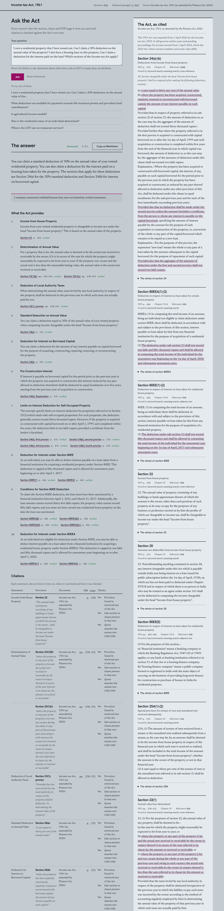
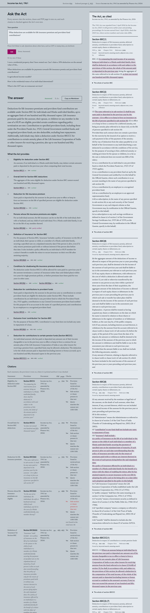
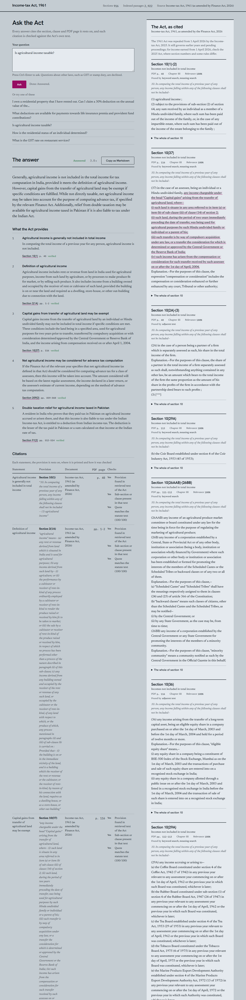

# Sample results

Every result below is generated by `backend/scripts/export_samples.py` from real runs of the pipeline; nothing is edited by hand. Re-run the script to reproduce it (cached answers cost no LLM calls).

- **Generated:** 2026-10-31
- **Source document:** Income-tax Act, 1961 (as amended by Finance Act, 2026) (As amended by the Finance Act, 2026 - CBDT consolidated text, incometaxindia.gov.in)
- **PDF:** income-tax-act-1961-as-amended-by-finance-act-2026.pdf · 1098 pages · SHA-256 `ecdd7ea6ef58415848a0bca8f88854c23f52dcb830e9ce7eb42b4520f30db2fc`
- **Models:** planner = gemini:gemini-3.5-flash-lite, embeddings = local:BAAI/bge-base-en-v1.5, reranker = BAAI/bge-reranker-base, generator = gemini:gemini-2.5-flash, verifier = gemini:gemini-3.5-flash-lite
- **Verified** means the cited section was retrieved, the sub-division / proviso / Explanation marker is present in its text, and the quote matches the statute.
- **Index:** these runs used the index from before the last parser fix. In that index, the numbered list of institutions inside 80C(2) was mislabelled as sub-sections. That is why the 80C(4)(i) citation below is marked "Partly": its quote matched exactly, but the pinpoint check could not confirm "(4)". With the corrected index and verifier, that check passes. These outputs were not regenerated because the free-tier quota (20 answers per model per day) ran out on 31 October 2026.

---

## House property (the example from the brief)

**Question:** I own a residential property that I have rented out. Can I claim a 30% deduction on the annual value of the property? I also have a housing loan on this property. Can I claim a deduction for the interest paid on the loan? Which sections of the Income-tax Act apply?

**Status:** Answered · **Confidence:** 99% (high)

**Answer:** You can claim a standard deduction of 30% on the annual value of your rented residential property. You can also claim a deduction for the interest paid on a housing loan taken for the property. The sections that apply for these deductions are Section 24(a) for the 30% standard deduction and Section 24(b) for interest on borrowed capital.

- **Income from House Property**: Income from your rented residential property is chargeable to income-tax under the head "Income from house property". This is based on the annual value of the property.
- **Determination of Annual Value**: For a property that is let, the annual value is deemed to be the actual rent received or receivable by the owner, if it is in excess of the sum for which the property might reasonably be expected to let from year to year. If the property was vacant and the actual rent is less than the reasonable letting value, the annual value is the actual rent received or receivable.
- **Deduction of Local Authority Taxes**: When determining the annual value, taxes levied by any local authority in respect of the property shall be deducted in the previous year in which such taxes are actually paid by you.
- **Standard Deduction on Annual Value**: You can claim a deduction equal to 30% of the annual value of your rented property when computing income chargeable under the head "Income from house property".
- **Deduction for Interest on Borrowed Capital**: You can claim a deduction for the amount of any interest payable on capital borrowed for the purpose of acquiring, constructing, repairing, renewing, or reconstructing the property.
- **Pre-Construction Interest**: If interest is payable on borrowed capital for the period prior to the previous year in which the property was acquired or constructed, this interest (reduced by any part allowed as deduction elsewhere) shall be deducted in equal instalments over five years, starting from the previous year of acquisition or construction.
- **Limits on Interest Deduction for Self-Occupied Property**: The excerpts specify limits on interest deduction for properties referred to in Section 23(2) (which deals with self-occupied properties). For such properties, the deduction generally cannot exceed thirty thousand rupees. However, if the property is acquired or constructed with capital borrowed on or after April 1, 1999, and completed within five years, the deduction limit is two lakh rupees, provided a certificate from the lender is furnished.
- **Deduction for Interest under Section 80EE**: As an individual, you may be able to deduct interest payable on a loan taken from a financial institution for acquiring a residential property under Section 80EE. This deduction is capped at fifty thousand rupees and is allowed for assessment years beginning on or after April 1, 2017.
- **Conditions for Section 80EE Deduction**: To claim the Section 80EE deduction, the loan must have been sanctioned by a financial institution between April 1, 2016, and March 31, 2017. Additionally, the loan amount cannot exceed thirty-five lakh rupees, the property value cannot exceed fifty lakh rupees, and you must not have owned any residential house property on the date the loan was sanctioned.
- **Deduction for Interest under Section 80EEA**: As an individual not eligible for deduction under Section 80EE, you may be able to deduct interest payable on a loan taken from a financial institution for acquiring a residential house property under Section 80EEA. This deduction is capped at one lakh and fifty thousand rupees and is allowed for assessment years beginning on or after April 1, 2020.

| Answer statement | Statutory reference | Quote (verbatim from the Act) | Source document | PDF page | Verified |
|---|---|---|---|---|---|
| Income from House Property | Section 22 | "The annual value of property consisting of any buildings or lands appurtenant thereto of which the assessee is the owner... shall be chargeable to income-tax under the head "Income from house property"." | Income-tax Act, 1961 (as amended by Finance Act, 2026) | p. 170 | Yes |
| Determination of Annual Value | Section 23(1)(b) | "where the property or any part of the property is let and the actual rent received or receivable by the owner in respect thereof is in excess of the sum referred to in clause (a), the amount so received or receivable" | Income-tax Act, 1961 (as amended by Finance Act, 2026) | pp. 170-171 | Yes |
| Determination of Annual Value | Section 23(1)(c) | "where the property or any part of the property is let and was vacant during the whole or any part of the previous year and owing to such vacancy the actual rent received or receivable by the owner in respect thereof is less than the sum referred to in clause (a), the amount so received or receivable" | Income-tax Act, 1961 (as amended by Finance Act, 2026) | pp. 170-171 | Yes |
| Deduction of Local Authority Taxes | Section 23(1), proviso | "Provided that the taxes levied by any local authority in respect of the property shall be deducted... in determining the annual value of the property" | Income-tax Act, 1961 (as amended by Finance Act, 2026) | pp. 170-171 | Yes |
| Standard Deduction on Annual Value | Section 24(a) | "a sum equal to thirty per cent of the annual value" | Income-tax Act, 1961 (as amended by Finance Act, 2026) | p. 172 | Yes |
| Deduction for Interest on Borrowed Capital | Section 24(b) | "where the property has been acquired, constructed, repaired, renewed or reconstructed with borrowed capital, the amount of any interest payable on such capital" | Income-tax Act, 1961 (as amended by Finance Act, 2026) | p. 172 | Yes |
| Pre-Construction Interest | Section 24(b), Explanation | "the interest, if any, payable on such capital borrowed for the period prior to the previous year in which the property has been acquired or constructed... shall be deducted under this clause in equal instalments for the said previous year and for each of the four immediately succeeding previous years" | Income-tax Act, 1961 (as amended by Finance Act, 2026) | p. 172 | Yes |
| Limits on Interest Deduction for Self-Occupied Property | Section 24(b), first proviso | "Provided that in respect of property referred to in sub-section (2) of section 23, the amount of deduction... shall not exceed thirty thousand rupees" | Income-tax Act, 1961 (as amended by Finance Act, 2026) | p. 172 | Yes |
| Limits on Interest Deduction for Self-Occupied Property | Section 24(b), second proviso | "Provided further that where the property referred to in the first proviso is acquired or constructed with capital borrowed on or after the 1st day of April, 1999... the amount of deduction... shall not exceed two lakh rupees." | Income-tax Act, 1961 (as amended by Finance Act, 2026) | p. 172 | Yes |
| Limits on Interest Deduction for Self-Occupied Property | Section 24(b), third proviso | "Provided also that no deduction shall be made under the second proviso unless the assessee furnishes a certificate, from the person to whom any interest is payable on the capital borrowed" | Income-tax Act, 1961 (as amended by Finance Act, 2026) | p. 172 | Yes |
| Limits on Interest Deduction for Self-Occupied Property | Section 24(b), fourth proviso | "Provided also that the aggregate of the amounts of deduction under the first and second provisos shall not exceed two lakh rupees." | Income-tax Act, 1961 (as amended by Finance Act, 2026) | p. 172 | Yes |
| Deduction for Interest under Section 80EE | Section 80EE(1) | "In computing the total income of an assessee, being an individual... there shall be deducted... interest payable on loan taken by him from any financial institution for the purpose of acquisition of a residential property." | Income-tax Act, 1961 (as amended by Finance Act, 2026) | p. 415 | Yes |
| Deduction for Interest under Section 80EE | Section 80EE(2) | "The deduction under sub-section (1) shall not exceed fifty thousand rupees and shall be allowed in computing the total income of the individual for the assessment year beginning on the 1st day of April, 2017 and subsequent assessment years." | Income-tax Act, 1961 (as amended by Finance Act, 2026) | p. 415 | Yes |
| Conditions for Section 80EE Deduction | Section 80EE(3)(i) | "the loan has been sanctioned by the financial institution during the period beginning on the 1st day of April, 2016 and ending on the 31st day of March, 2017" | Income-tax Act, 1961 (as amended by Finance Act, 2026) | p. 415 | Yes |
| Conditions for Section 80EE Deduction | Section 80EE(3)(ii) | "the amount of loan sanctioned for acquisition of the residential house property does not exceed thirty-five lakh rupees" | Income-tax Act, 1961 (as amended by Finance Act, 2026) | p. 415 | Yes |
| Conditions for Section 80EE Deduction | Section 80EE(3)(iii) | "the value of residential house property does not exceed fifty lakh rupees" | Income-tax Act, 1961 (as amended by Finance Act, 2026) | p. 415 | Yes |
| Conditions for Section 80EE Deduction | Section 80EE(3)(iv) | "the assessee does not own any residential house property on the date of sanction of loan." | Income-tax Act, 1961 (as amended by Finance Act, 2026) | p. 415 | Yes |
| Deduction for Interest under Section 80EEA | Section 80EEA(1) | "In computing the total income of an assessee, being an individual not eligible to claim deduction under section 80EE, there shall be deducted... interest payable on loan taken by him from any financial institution for the purpose of acquisition of a residential house property." | Income-tax Act, 1961 (as amended by Finance Act, 2026) | p. 416 | Yes |
| Deduction for Interest under Section 80EEA | Section 80EEA(2) | "The deduction under sub-section (1) shall not exceed one lakh and fifty thousand rupees and shall be allowed in computing the total income of the individual for the assessment year beginning on the 1st day of April, 2020 and subsequent assessment years." | Income-tax Act, 1961 (as amended by Finance Act, 2026) | p. 416 | Yes |

**Caveats:** Assumes the housing loan was taken from a 'financial institution' as defined in the Act, if considering deductions under Section 80EE or 80EEA.; Assumes the property is not self-occupied, as the user stated it is rented out. Limits on interest deduction under Section 24(b) for self-occupied properties (referred to in Section 23(2)) would not apply to your rented property.; Assumes the user meets all specific conditions (e.g., loan sanction dates, property value, non-ownership of other property) for claiming deductions under Section 80EE or 80EEA.

**Warnings shown to the user:**
- 1 summary sentence(s) withheld because they were not backed by verified statements.

**Removed by the verifier:** 0 statement(s), 1 summary sentence(s).

---

## Chapter VI-A deduction

**Question:** What deductions are available for life insurance premium and provident fund contributions?

**Status:** Answered · **Confidence:** 97% (high)

**Answer:** Deductions for life insurance premiums and provident fund contributions are available under Section 80C for individuals and Hindu undivided families, up to an aggregate limit of one hundred and fifty thousand rupees. Life insurance premiums paid for the assessee, their spouse, or children (or any member in the case of a HUF) are eligible, provided certain conditions regarding policy termination are met. Contributions to specified provident funds, including those under the Provident Funds Act, 1925, Central Government notified funds, and recognised provident funds, are also deductible, excluding loan repayments. Additionally, individuals may claim a deduction under Section 80CCC for contributions to certain annuity plans of the Life Insurance Corporation of India or other insurers for receiving a pension, also up to one hundred and fifty thousand rupees.

- **Eligibility for deduction under Section 80C**: An assessee, if an individual or a Hindu undivided family, may deduct certain amounts paid or deposited in the previous year when computing their total income.
- **Overall limit for Section 80C deductions**: The aggregate of the sums eligible for deduction under Section 80C cannot exceed one hundred and fifty thousand rupees.
- **Deduction for life insurance premium**: Sums paid or deposited by the assessee in the previous year to effect or keep in force an insurance on the life of specified persons are eligible for deduction under Section 80C.
- **Persons whose life insurance premiums are eligible**: For an individual assessee, the life insurance can be on the life of the individual, their wife or husband, and any child of such individual. For a Hindu undivided family, it can be on the life of any member thereof.
- **Definition of 'insurance' for Section 80C**: For the purpose of Section 80C, 'insurance' includes a policy of insurance on the life of an individual, their spouse or child, or a member of a Hindu undivided family, securing a specified sum on a stipulated maturity date if the person is alive, even if it only returns premiums paid (with or without interest) if the person dies before that date. It also includes a policy effected by an individual or HUF member for a minor's benefit to enable the minor to secure insurance on their own life after attaining majority.
- **Conditions for disallowing life insurance premium deduction**: No deduction under Section 80C(1) will be allowed for sums paid in a previous year if the assessee terminates a contract of insurance (other than unit-linked plans) within two years for single premium policies, or before premiums have been paid for two years in other cases.
- **Deduction for contributions to provident funds**: Sums paid or deposited by the assessee in the previous year as contributions to certain provident funds are eligible for deduction under Section 80C. These include contributions by an individual to any provident fund to which the Provident Funds Act, 1925 applies, contributions to any Central Government provident fund notified for this purpose (if to an account in the name of a specified person), and contributions by an employee to a recognised provident fund.
- **Exclusion from 'contribution' for Section 80C**: For the purpose of Section 80C, 'contribution' to any fund does not include any sums in repayment of a loan.
- **Deduction for contributions to certain pension funds (Section 80CCC)**: An individual assessee who has paid or deposited any amount out of their income chargeable to tax in the previous year to effect or keep in force a contract for an annuity plan of the Life Insurance Corporation of India or any other insurer for receiving a pension from a specified fund, may be allowed a deduction. The deduction is for the whole amount paid or deposited (excluding interest or bonus accrued), up to one hundred and fifty thousand rupees in the previous year.

| Answer statement | Statutory reference | Quote (verbatim from the Act) | Source document | PDF page | Verified |
|---|---|---|---|---|---|
| Eligibility for deduction under Section 80C | Section 80C(1) | "In computing the total income of an assessee, being an individual or a Hindu undivided family, there shall be deducted, in accordance with and subject to the provisions of this section, the whole of the amount paid or deposited in the previous year" | Income-tax Act, 1961 (as amended by Finance Act, 2026) | p. 394 | Yes |
| Overall limit for Section 80C deductions | Section 80C(1) | "as does not exceed one hundred and fifty thousand rupees." | Income-tax Act, 1961 (as amended by Finance Act, 2026) | p. 394 | Yes |
| Deduction for life insurance premium | Section 80C(2)(i) | "The sums referred to in sub-section (1) shall be any sums paid or deposited in the previous year by the assessee— (i) to effect or to keep in force an insurance on the life of persons specified in sub-section (4)" | Income-tax Act, 1961 (as amended by Finance Act, 2026) | p. 395 | Yes |
| Persons whose life insurance premiums are eligible | Section 80C(4)(i) | "in the case of an individual, the individual, the wife or husband and any child of such individual, and (ii) in the case of a Hindu undivided family, any member thereof;" | Income-tax Act, 1961 (as amended by Finance Act, 2026) | p. 400 | Partly |
| Definition of 'insurance' for Section 80C | Section 80C(8)(iii) | "insurance" shall include— (a) a policy of insurance on the life of an individual or the spouse or the child of such individual or a member of a Hindu undivided family securing the payment of specified sum on the stipulated date of maturity, if such person is alive on such date notwithstanding that the policy of insurance provides only for the return of premiums paid (with or without any interest thereon) in the event of such person dying before the said stipulated date; (b) a policy of insurance effected by an individual or a member of a Hindu undivided family for the benefit of a minor with the object of enabling the minor, after he has attained majority to secure insurance on his own life by adopting the policy and on his being alive on a date (after such adoption) specified in the policy in this behalf;" | Income-tax Act, 1961 (as amended by Finance Act, 2026) | pp. 401-402 | Yes |
| Conditions for disallowing life insurance premium deduction | Section 80C(5)(i) | "Where, in any previous year, an assessee— (i) terminates his contract of insurance referred to in clause (i) of sub-section (2), by notice to that effect or where the contract ceases to be in force by reason of failure to pay any premium, by not reviving contract of insurance,— (a) in case of any single premium policy, within two years after the date of commencement of insurance; or (b) in any other case, before premiums have been paid for two years; or" | Income-tax Act, 1961 (as amended by Finance Act, 2026) | p. 400 | Yes |
| Conditions for disallowing life insurance premium deduction | Section 80C(5)(a) | "then,— (a) no deduction shall be allowed to the assessee under sub-section (1) with reference to any of the sums, referred to in clauses (i), (x), (xi) and (xviii) of sub-section (2), paid in such previous year;" | Income-tax Act, 1961 (as amended by Finance Act, 2026) | p. 400 | Yes |
| Deduction for contributions to provident funds | Section 80C(2) | "The sums referred to in sub-section (1) shall be any sums paid or deposited in the previous year by the assessee— (iv) as a contribution by an individual to any provident fund to which the Provident Funds Act, 1925 (19 of 1925) applies; (v) as a contribution to any provident fund set up by the Central Government and notified by it in this behalf in the Official Gazette, where such contribution is to an account standing in the name of any person specified in sub-section (4); (vi) as a contribution by an employee to a recognised provident fund;" | Income-tax Act, 1961 (as amended by Finance Act, 2026) | p. 395 | Yes |
| Exclusion from 'contribution' for Section 80C | Section 80C(8)(ii) | "contribution" to any fund shall not include any sums in repayment of loan;" | Income-tax Act, 1961 (as amended by Finance Act, 2026) | pp. 401-402 | Yes |
| Deduction for contributions to certain pension funds (Section 80CCC) | Section 80CCC(1) | "Where an assessee being an individual has in the previous year paid or deposited any amount out of his income chargeable to tax to effect or keep in force a contract for any annuity plan of Life Insurance Corporation of India or any other insurer for receiving pension from the fund referred to in clause (23AAB) of section 10, he shall, in accordance with, and subject to, the provisions of this section, be allowed a deduction in the computation of his total income, of the whole of the amount paid or deposited (excluding interest or bonus accrued or credited to the assessee's account, if any) as does not exceed the amount of one hundred and fifty thousand rupees in the previous year." | Income-tax Act, 1961 (as amended by Finance Act, 2026) | pp. 404-405 | Yes |

---

## Exemption and definition

**Question:** Is agricultural income taxable?

**Status:** Answered · **Confidence:** 95% (high)

**Answer:** Generally, agricultural income is not included in the total income for tax computation in India, provided it meets the definition of agricultural income. However, capital gains from the transfer of agricultural land may be exempt if specific conditions are fulfilled. While not directly taxable, net agricultural income may be taken into account for the purpose of computing advance tax, if specified by the relevant Finance Act. Additionally, relief from double taxation may be available for agricultural income taxed in Pakistan if it is also liable to tax under the Indian Act.

- **Agricultural income is generally not included in total income**: In computing the total income of a previous year for any person, agricultural income is not included.
- **Definition of agricultural income**: Agricultural income includes rent or revenue from land in India used for agricultural purposes, income from such land by agriculture, or by processes to make produce fit for market, or by selling such produce. It also includes income from a building owned and occupied by the receiver of rent or cultivator of such land, provided the building is on or near the land and required as a dwelling, store-house, or other out-building due to connection with the land.
- **Capital gains from transfer of agricultural land may be exempt**: Capital gains income from the transfer of agricultural land by an individual or Hindu undivided family may not be included in total income if specific conditions are met. These conditions include the land being in a specified area, used for agricultural purposes for two years prior to transfer, transferred by compulsory acquisition or with consideration determined/approved by the Central Government or Reserve Bank of India, and the income arising from compensation received on or after April 1, 2004.
- **Net agricultural income may be considered for advance tax computation**: If the Finance Act of the relevant year specifies that net agricultural income (as defined in that Act) should be considered for computing advance tax for a class of assessees, then this income will be taken into account. The amount considered will be based on the latest regular assessment, the income declared in a later return, or the assessee's estimate of current income, depending on the method of advance tax computation.
- **Double taxation relief for agricultural income taxed in Pakistan**: A resident in India who proves that they paid tax in Pakistan on agricultural income accrued or arisen there, and that this income is also liable to tax under the Indian Income-tax Act, is entitled to a deduction from Indian income-tax. The deduction is the lesser of the tax paid in Pakistan or a sum calculated on that income at the Indian rate of tax.

| Answer statement | Statutory reference | Quote (verbatim from the Act) | Source document | PDF page | Verified |
|---|---|---|---|---|---|
| Agricultural income is generally not included in total income | Section 10(1) | "10. In computing the total income of a previous year of any person, any income falling within any of the following clauses shall not be included— (1) agricultural income" | Income-tax Act, 1961 (as amended by Finance Act, 2026) | p. 48 | Yes |
| Definition of agricultural income | Section 2(1A) | "agricultural income" means— (a) any rent or revenue derived from land which is situated in India and is used for agricultural purposes; (b) any income derived from such land by— (i) agriculture; or (ii) the performance by a cultivator or receiver of rent-in-kind of any process ordinarily employed by a cultivator or receiver of rent-in-kind to render the produce raised or received by him fit to be taken to market; or (iii) the sale by a cultivator or receiver of rent-in-kind of the produce raised or received by him, in respect of which no process has been performed other than a process of the nature described in paragraph (ii) of this sub-clause; (c) any income derived from any building owned and occupied by the receiver of the rent or revenue of any such land, or occupied by the cultivator or the receiver of rent-in-kind, of any land with respect to which, or the produce of which, any process mentioned in paragraphs (ii) and (iii) of sub-clause (b) is carried on : Provided that— (i) the building is on or in the immediate vicinity of the land, and is a building which the receiver of the rent or revenue or the cultivator, or the receiver of rent-in-kind, by reason of his connection with the land, requires as a dwelling house, or as a store-house, or other out-building" | Income-tax Act, 1961 (as amended by Finance Act, 2026) | pp. 1-2 | Yes |
| Capital gains from transfer of agricultural land may be exempt | Section 10(37) | "any income chargeable under the head "Capital gains" arising from the transfer of agricultural land, where— (i) such land is situate in any area referred to in item (a) or item (b) of sub-clause (iii) of clause (14) of section 2; (ii) such land, during the period of two years immediately preceding the date of transfer, was being used for agricultural purposes by such Hindu undivided family or individual or a parent of his; (iii) such transfer is by way of compulsory acquisition under any law, or a transfer the consideration for which is determined or approved by the Central Government or the Reserve Bank of India; (iv) such income has arisen from the compensation or consideration for such transfer received by such assessee on or after the 1st day of April, 2004." | Income-tax Act, 1961 (as amended by Finance Act, 2026) | p. 116 | Yes |
| Net agricultural income may be considered for advance tax computation | Section 209(2) | "Where the Finance Act of the relevant year provides that, in the case of any class of assessees, net agricultural income (as defined in that Act) shall be taken into account for the purposes of computing advance tax, then, the net agricultural income to be taken into account in the case of any assessee falling in that class, shall be— (a) in cases where the Assessing Officer makes an order under sub-section (3) or sub-section (4) of section 210,— (i) if the total income of the latest previous year in respect of which the assessee has been assessed by way of regular assessment forms the basis of computation of advance tax payable by him, the net agricultural income which has been taken into account for the purposes of charging income-tax for the assessment year relevant to that previous year; or (ii) if the total income declared by the assessee for the later previous year referred to in sub-section (4) of section 210 forms the basis of computation of advance tax, the net agricultural income as returned by the assessee in the return of income for the assessment year relevant to such later previous year; (b) in cases where the advance tax is paid by the assessee on the basis of his estimate of his current income under sub-section (1) or sub-section (2) or sub-section (5) or sub-section (6) of section 210, the net agricultural income, as estimated by him, of the period which would be the previous year for the immediately following assessment year." | Income-tax Act, 1961 (as amended by Finance Act, 2026) | pp. 859-860 | Yes |
| Double taxation relief for agricultural income taxed in Pakistan | Section 91(2) | "If any person who is resident in India in any previous year proves that in respect of his income which accrued or arose to him during that previous year in Pakistan he has paid in that country, by deduction or otherwise, tax payable to the Government under any law for the time being in force in that country relating to taxation of agricultural income, he shall be entitled to a deduction from the Indian income-tax payable by him— (a) of the amount of the tax paid in Pakistan under any law aforesaid on such income which is liable to tax under this Act also; or (b) of a sum calculated on that income at the Indian rate of tax; whichever is less." | Income-tax Act, 1961 (as amended by Finance Act, 2026) | pp. 513-514 | Yes |

---

## Question outside the Act (abstention)

**Question:** What is the GST rate on restaurant services?

**Status:** Insufficient support · **Confidence:** n/a

**Answer:** No provision of the Act retrieved for this question is relevant enough to support an answer. The closest provisions found are listed below for reference, but they should not be read as answering the question.

Closest provisions shown for reference only: Eleventh Schedule, item 10, Section 92CE(1), Section 43A(b)

---
